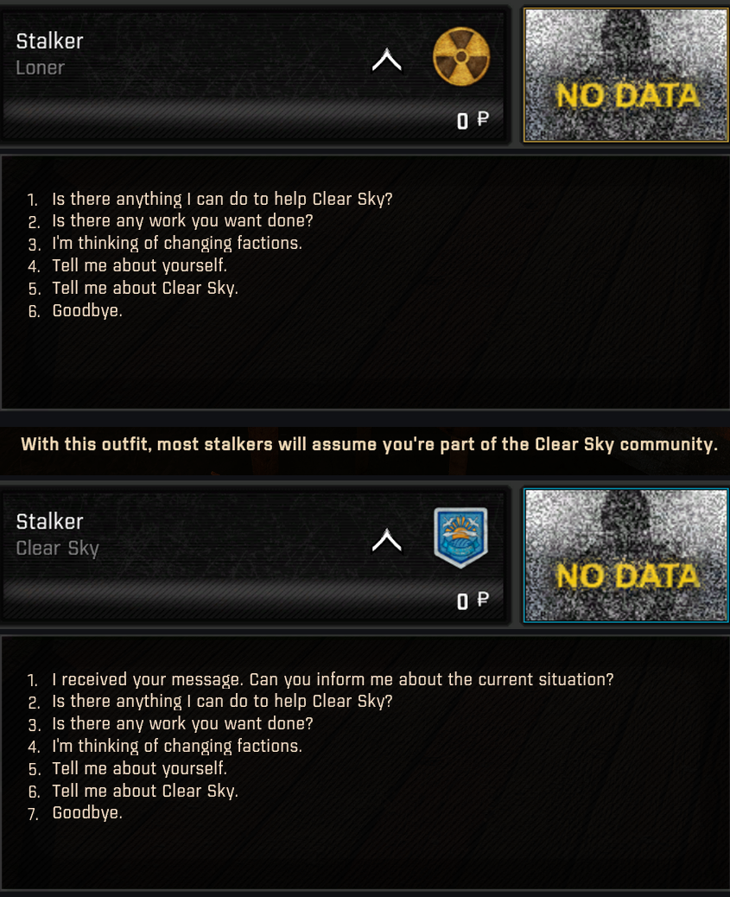
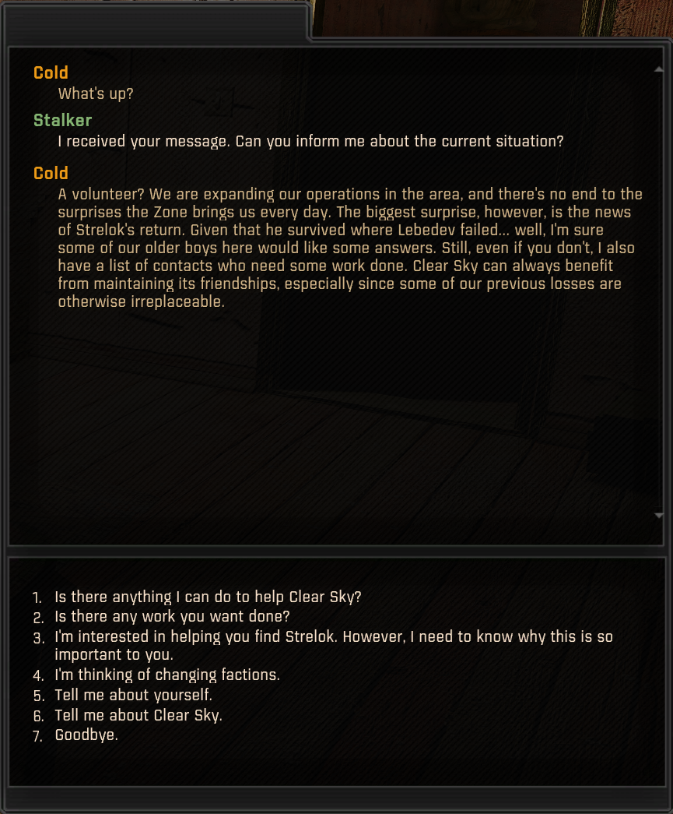

# GAMMA Disguise Main Quest Access

Lets a character in the S.T.A.L.K.E.R. Anomaly modpack G.A.M.M.A. take the main
story lines while wearing a faction disguise. Anomaly opens these conversations
only for the faction you really belong to; this mod makes them follow the
faction you are disguised as.

- **Story quest lines:** the first talk about them with Sidorovich, Petrenko,
  Lukash, Cold, Sakharov and Dushman.
- **Living Legend, Mortal Sin and Operation Afterglow:** from taking them to
  reporting back.
- **Urgent Orders** from iTheon's New Tasks, given by Duty and the Army. The
  task remembers which of the two gave it.

Wear the disguise when you talk to the leader. Urgent Orders arrives by message
instead, so wear it when you arrive in the Bar or Agroprom. Anomaly's disguise
itself is unchanged, and some story lines still depend on your real faction;
see the README.

## Screenshots

*The same Loner twice. Without a disguise, Cold has no story topic for him. After he puts on a Clear Sky suit unseen, the game's own disguise takes effect, he is listed as Clear Sky, and Cold offers the first talk about the story quest lines.*

*Choosing it: Cold briefs him as a Clear Sky volunteer, and Living Legend's first topic appears.*

## Download

Download the `.7z` from
[Releases](https://github.com/Q4ln/GAMMA-Disguise-Main-Quest-Access/releases/latest)
and install it with Mod Organizer 2's **Install Mod** button.

## Documentation

Requirements, installation, compatibility, saves, known issues, the changelog
and credits are in
[GAMMA Disguise Main Quest Access - README.md](https://github.com/Q4ln/GAMMA-Disguise-Main-Quest-Access/blob/main/GAMMA%20Disguise%20Main%20Quest%20Access%20-%20README.md),
which also ships inside the archive.

Apart from this page and its screenshots, the repository holds exactly the
files in the release archive.

## Licence

The author's changes are by Q4ln under CC BY-NC-SA 4.0; see
[GAMMA Disguise Main Quest Access - LICENSE.txt](https://github.com/Q4ln/GAMMA-Disguise-Main-Quest-Access/blob/main/GAMMA%20Disguise%20Main%20Quest%20Access%20-%20LICENSE.txt).
The GAMMA and Anomaly files it ships edited copies of remain under their
authors' terms.
